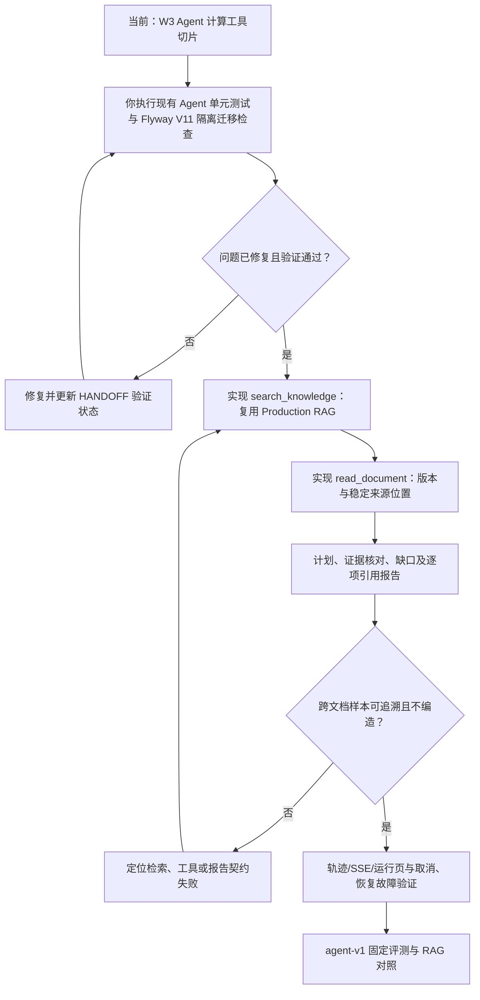

# PB-RAG 功能级甘特图与当前焦点

> 基准：2026-11-22 静态核对代码、`HANDOFF.md` 和 `retrieval-v1` 报告。W1～W6 是路线图的相对周次，不对应未经确认的日历起止日。本表是执行视图；验收标准以 `ROADMAP_6_WEEKS.md` 为准。

图例：`●` 已实现且有对应验证记录；`◐` 已实现但验证不足；`◇` 计划实施；`·` 不安排。`●` 不代表该功能所有故障场景均已覆盖。完成度不使用主观百分比；每行以证据和验收门槛更新状态。

| 功能点 / 交付物 | W1 | W2 | W3 当前 | W4 | W5 | W6 | 当前证据或验收门槛 |
| --- | :---: | :---: | :---: | :---: | :---: | :---: | --- |
| Spring Boot/Vue、数据库、Flyway、Trace 骨架 | ● | · | · | · | · | · | 后端和前端已有实现；见 `HANDOFF.md` 最近验证 |
| Markdown/PDF 解析、分块、Embedding、版本化引用 | ● | · | · | · | · | · | 入库与问答链路已实现；多实例故障验证仍在 W4/W5 |
| Job 幂等、租约、重试、取消、版本原子切换 | ◐ | ● | · | ◇ | ◇ | · | PostgreSQL 可靠性集成测试 10/10；多实例取消和故障注入待补 |
| Vue 上传、阶段、会话、SSE 问答、引用 | ● | ● | · | ◇ | · | · | 主要页面已实现；流断连和刷新恢复待回归 |
| Vector/BM25、RRF、Rerank、Context 阶段追踪 | · | ● | · | · | ◇ | · | `retrieval-v1` 40 条正式基线；模型或语料变化需重评 |
| 无证据拒答、RAG 引用与质量基线 | · | ● | · | · | ◇ | · | 8/8 不可回答样本正确拒答；引用准确率/成本待补 |
| Agent Run/Step/Tool Execution、计算工具循环 | · | · | ◐ | · | · | · | 一次真实模型运行；新增单元测试尚未执行，V11 待隔离迁移检查 |
| Agent 架构与 RAG/Agent 适用边界讲解 | · | · | ◇ | · | · | ◇ | 用一条固定问答与一条 Run 轨迹解释模型、Runtime、工具、Observation；W6 用实测结果复盘 |
| `search_knowledge`：复用检索及资源作用域 | · | · | ◇ | · | · | · | 尚未实现；验收含当前版本、门槛、来源位置、跨库拒绝 |
| `read_document`：定点读取与稳定引用 | · | · | ◇ | · | · | · | 尚未实现；验收含文档版本、位置、参数边界和作用域 |
| 有界计划、跨文档核对、缺口和引用报告 | · | · | ◇ | ◇ | · | · | 尚未实现；先完成一条跨文档调研主路径 |
| 计划、ReAct 与持久化状态的可回放验证 | · | · | ◇ | ◇ | ◇ | · | 核对计划变更、工具选择、Run/Step/Tool Execution、取消和恢复语义；不展示隐藏思维过程 |
| Agent 轨迹查询、SSE、运行页与取消 | · | · | ◇ | ◇ | · | · | 同步查询/取消入口已有；轨迹 API、SSE、前端交互待做 |
| Agent 租约续期、重启恢复、超时与竞争 | · | · | · | ◇ | ◇ | · | 已有租约字段与边界检查；恢复调度和故障验证待做 |
| 工具策略、脱敏审计、Prompt Injection 实验 | · | · | ◐ | ◇ | ◇ | · | calculator 有白名单及参数校验；知识工具策略和实验待做 |
| `agent-v1` 数据集、引用/成功率/成本基线 | · | · | ◇ | ◇ | ◇ | · | 数据集尚不存在；覆盖单文档、跨文档、冲突、无证据 |
| QMS 与设计协同两组场景数据及任务 | · | · | ◇ | ◇ | ◇ | ◇ | 先 QMS 后设计协同；用虚构/获准脱敏材料，分别验证跨文档与规范/项目快照核查；见场景文档 |
| RAG/Agent 对照、故障报告和性能优化 | · | · | · | · | ◇ | ◇ | 同语料、固定版本对照；故障需复现、Trace 与回归 |
| 部署文档、演示脚本、作品复盘 | · | · | · | · | · | ◇ | 新环境部署与 10～15 分钟双主线演示 |

附图中的多 Agent 协作、LangGraph 框架和 Code Interpreter 是六周后的研究与实验项，不计入本图的完成度；对应门槛见路线图的“Agent 知识点如何嵌入项目”。

## 当前行动图

**当前最小可验收交付物：**在同一 Workspace/知识库中，Agent 针对一个需要两份文档的任务，进行多轮只读查找，输出分项结论、文档版本和稳定位置引用，并明确缺失证据；Run/Step/Tool Execution 能定位每一步。单次成功只是主路径验证，取消、超时和恢复仍需分别验收。

**更新规则：**功能状态只在代码实现和相应验证证据都具备时改为 `●`。每周复核一次本表，并同步 `HANDOFF.md`；若范围或验收标准变化，先更新路线图与相应 ADR。P2 的 Skill、写工具审批、MCP、LangGraph4j 对照不进入本六周甘特图。
