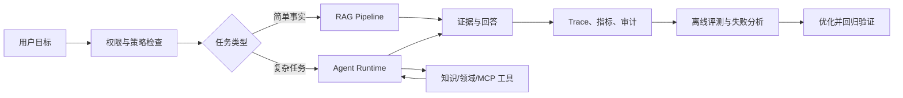
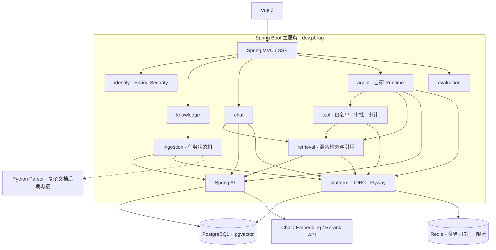
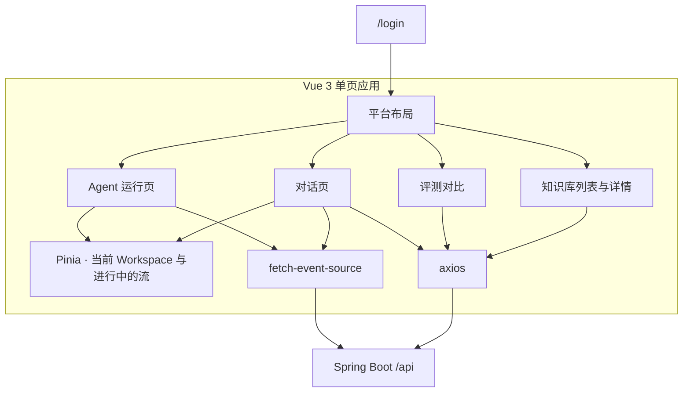
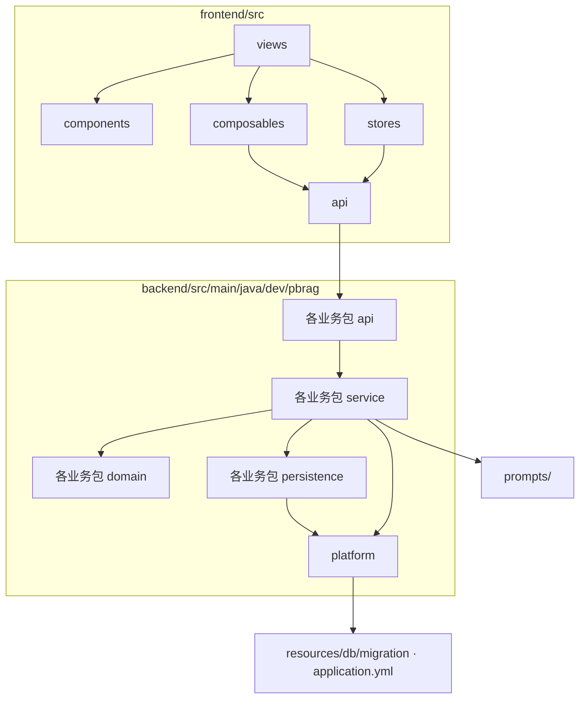
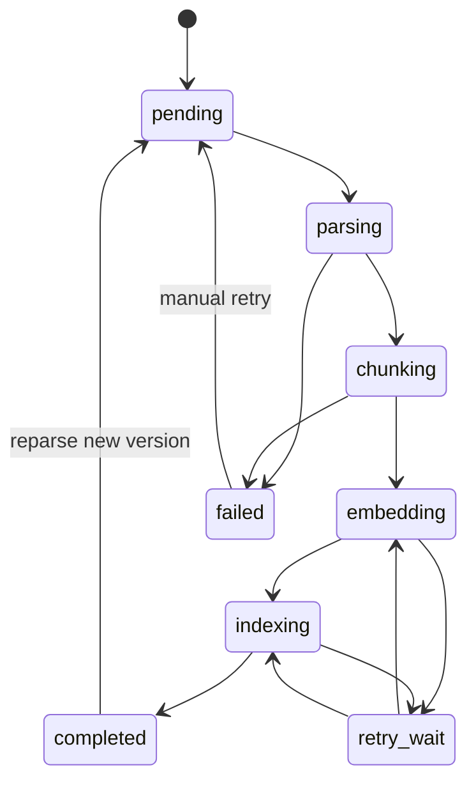
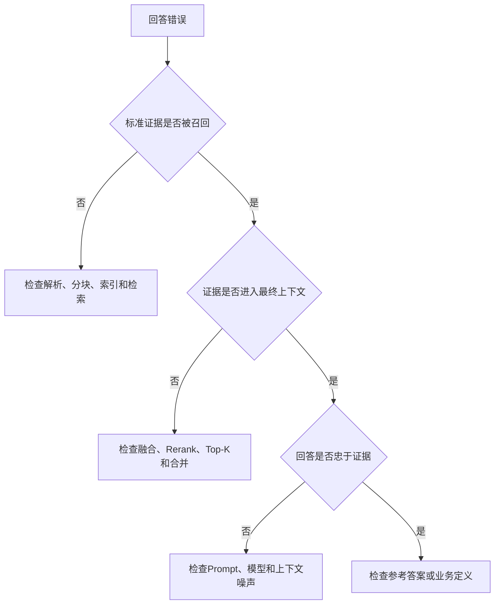
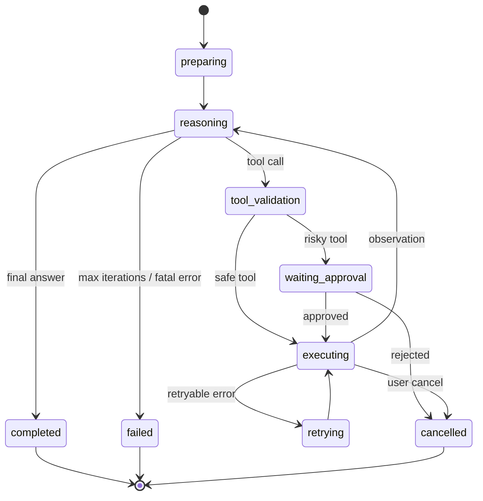

# PB-RAG 企业级 Agent 工程实战方案

> 方案版本：v0.2
> 日期：2026-10-24，技术栈修订：2026-10-27
> 适用对象：已有全栈开发经验、深度使用过 WeKnora，但缺少企业级 Agent 开发经历的开发者
> 项目目标：以 WeKnora 为参考实现，独立完成一套精简、完整、可评测、可治理的企业知识 Agent 核心系统。
> 执行说明：本文保留完整知识地图；实际时间安排以 `docs/ROADMAP_6_WEEKS.md` 为准。主服务技术栈以 `docs/adr/0001-主服务采用-spring-boot-与-spring-ai.md` 为准。

---

## 1. 项目目标

本项目不是复刻 WeKnora，也不是为 WeKnora 换一套界面，而是把 WeKnora 当作：

- 企业级 Agent 系统的参考实现；
- 源码解剖对象；
- 架构设计案例；
- 故障处理案例库；
- 我们验证自身设计的对照组。

最终需要获得两类成果。

### 1.1 能力成果

完成项目后，应当具备以下能力：

1. 能独立设计并实现 Agent Runtime；
2. 能搭建可评测的企业 RAG 链路；
3. 能设计可靠的 Tool、Skill 和 MCP 接入机制；
4. 能处理上下文、记忆、任务状态与中断恢复；
5. 能处理权限、审批、审计、隔离和提示词注入风险；
6. 能通过指标与评测分析效果、延迟和成本；
7. 能解释一个 Agent 系统从 Demo 到生产环境之间的工程差距。

### 1.2 作品成果

最终至少形成以下可展示成果：

- 一套可运行的 PB-RAG 企业知识 Agent；
- 一个自主实现的轻量 Agent Runtime；
- 一套 RAG 与 Agent 离线评测系统；
- 一套企业权限、工具审批和审计机制；
- 一组故障注入与恢复实验；
- 完整的架构文档、ADR、测试报告和评测报告；
- 一篇能够对外讲清技术取舍的项目总结。

项目价值不以页面数量和模型供应商数量衡量，而以“核心机制能否解释、异常能否处理、效果能否验证”为标准。

---

## 2. 最终产品定义

### 2.1 产品定位

PB-RAG 是一套面向团队知识工作的企业级 Agent 核心系统。用户能够：

1. 创建工作空间与知识库；
2. 导入文档并查看处理进度；
3. 基于资料进行带引用的快速问答；
4. 使用 Agent 完成跨文档、多步骤任务；
5. 查看 Agent 的执行步骤、工具调用和依据；
6. 对高风险工具调用进行人工审批；
7. 通过评测与追踪分析失败原因。

### 2.2 首个垂直场景

第一版采用“团队技术知识 Agent”作为默认场景：

- 导入需求文档、架构设计、API 文档、故障复盘和开发规范；
- 回答带有出处的技术问题；
- 跨多份设计文档比较方案；
- 生成技术调研或故障分析报告；
- 调用只读项目状态工具获取结构化信息。

选择该场景的原因：

- 自己可以生产和判断数据；
- 问题是否回答正确相对容易验证；
- 同时覆盖单跳 RAG、多跳检索和工具调用；
- 后续容易扩展到代码仓库 Agent。

### 2.3 明确不做的内容

第一阶段不追求：

- 支持所有文档格式；
- 支持十几种向量数据库；
- 支持几十家模型厂商；
- 自动 Wiki 全功能；
- 大量 IM 渠道；
- 复杂多 Agent 编排；
- 任意 Shell 和无限制网络访问；
- 商业化计费系统；
- 为了展示而堆叠 GraphRAG、长期记忆等概念。

只有当评测或真实场景证明需要时，才增加相应能力。

---

## 3. 项目完成标准

一个问题从进入系统到完成，必须具备以下闭环：



达到以下条件，项目才算“企业级核心闭环完成”：

- 数据导入是异步、可重试、可观测和幂等的；
- 回答拥有可验证引用；
- RAG 和 Agent 使用同一权限边界；
- Agent 的每次工具调用可追踪、可取消、可超时；
- 高风险操作支持审批；
- 服务重启后可以恢复或明确终止任务；
- 修改检索、Prompt 或模型后，可以用相同评测集回归；
- 可以解释一次失败发生在哪个阶段；
- 可以统计任务成功率、延迟和成本。

---

## 4. 总体架构

### 4.1 系统架构图

目标结构以 ADR 0001 为准。`backend` 中对应包已经建立，请求链路尚未接通。PostgreSQL 和 Redis 是外部服务器，地址写在 `backend/src/main/resources/application.yml`。



Spring AI 提供模型、Embedding、工具 Schema 和第一周向量读写。检索编排、Agent 循环、权限、任务状态、引用和评测位于上面的业务包中。

### 4.2 前端架构

已由 ADR 0002 接受。前端是独立的 Vue 3 单页应用，只覆盖演示主路径。开发时 Vite 将 `/api` 代理到 Spring Boot。路由守卫只选择页面；Workspace 隔离、检索过滤和工具权限由后端执行。



对话页左侧是消息，右侧是引用和检索阶段。运行页左侧是 Run/Step，右侧是工具参数、审批和取消。知识库详情展示上传后的阶段、失败原因和重试。

第 1 周交付知识库详情和对话页。运行页在第 3 周加入，审批在第 4 周加入，评测对比在第 5 周加入。嵌入页、桌面端、多语言、组织、设置中心、工具箱、Wiki 和 Office 在线预览不进入第一期。

### 4.3 代码架构

代码按依赖方向分层。页面不直接访问数据库，控制器不直接调用模型和 SQL。当前仓库里后端只有 `dev.pbrag` 的包说明和启动类；下面的分层在出现真实类时再创建，不预先铺空目录。



业务包是 `identity`、`knowledge`、`ingestion`、`retrieval`、`chat`、`agent`、`tool`、`evaluation` 和 `observability`。每个包内部使用同一套分层：

| 分层 | 代码放什么 |
|---|---|
| `api` | Spring MVC 控制器和 SSE 端点，只做参数校验和响应转换 |
| `service` | 用例：入库阶段推进、检索编排、Agent 循环、审批 |
| `domain` | 状态、不变量和错误分类，不依赖 Spring Web |
| `persistence` | Spring Data JDBC 与本包 SQL，查询带 Workspace 条件 |

包之间只允许这些调用：`knowledge` 调用 `ingestion`，`chat` 调用 `retrieval`，`agent` 调用 `tool` 和 `retrieval`，`tool` 调用 `retrieval`。需要鉴权时调用 `identity`。`observability` 提供 Trace 标识，不承载业务决策。`platform` 集中放置 JDBC、Flyway 和 Spring AI 的 `ChatModel`、`EmbeddingModel`、`ToolCallback`、`PgVectorStore` 适配。业务包通过 `platform` 使用这些基础设施。

`prompts/` 保存版本化的运行时提示词。`frontend` 只通过 `/api` 访问后端。

### 4.4 技术栈

已由 ADR 0001 接受。脚手架初始化时锁定 Spring Boot 与 Spring AI 的 GA 版本。

| 层 | 技术 | 选择理由 |
|---|---|---|
| Web | Vue 3、TypeScript、Vite、Vue Router、Pinia、TDesign | 沿用 WeKnora 的主路径技术骨架，页面只保留演示闭环 |
| API | Java 21、Spring Boot、Spring MVC、虚拟线程 | 贴合 Java 企业开发经验；阻塞模型足够表达 SSE、超时和取消 |
| 模型与工具基础设施 | Spring AI | 复用 `ChatModel`、`EmbeddingModel`、工具 Schema、向量基线和观测 |
| 持久化 | Spring Data JDBC 或 `JdbcTemplate`、Flyway | 混合检索、版本和权限过滤需要明确 SQL |
| 解析 | 首期 Java；复杂文档再接 Python | 六周内先统一主链路，解析重依赖再隔离 |
| 数据库 | PostgreSQL + pgvector | 业务数据和向量数据统一，减少组件 |
| 关键词检索 | PostgreSQL FTS 或 ParadeDB | 先完成混合检索，不急于引入 ES |
| 任务 | PostgreSQL 任务表；Redis 负责唤醒、取消标记和限流 | 恢复与业务事务一致，并保留异步执行 |
| 对象存储 | 本地接口 + MinIO 实现 | 开发简单，同时保留替换能力 |
| 可观测 | Micrometer Observation、OpenTelemetry、按需 Langfuse | 覆盖应用 Trace、模型 Trace 和成本 |
| 测试 | JUnit 5 + Testcontainers | 数据库、队列和隔离测试可重复 |
| 安全 | Spring Security | 鉴权在检索和工具执行前生效 |
| 部署 | Docker Compose | 能复现完整环境，后期再研究 Kubernetes |

Spring AI 不承担整个系统架构。Agent Runtime、Production RAG、Workspace 隔离、审批、审计、任务状态、引用和评测仍由 PB-RAG 实现。框架自带的 RAG Advisor 和 Tool Loop 只作为第 5 周的对照基线。

### 4.5 模块化单体优先

第一阶段采用包级模块化单体，不主动拆微服务。Markdown 和普通 PDF 的解析留在主进程；复杂版面、OCR、表格和 Office 文档再拆出 Python 解析服务。

建议模块以 Java 包划分，包根在脚手架初始化时确定：

```text
<root>/
├── identity/        # 用户、Workspace、角色、API Key
├── knowledge/       # 知识库、文档、版本、Chunk
├── ingestion/       # 入库任务与阶段状态机
├── retrieval/       # 向量、关键词、融合、Rerank
├── chat/            # 会话、消息、引用、流式输出
├── agent/           # Agent Runtime、上下文、循环控制
├── tool/            # Tool Registry、执行、审批、审计
├── evaluation/      # 数据集、运行、指标、对比
├── observability/   # Trace、Metric、日志
└── platform/        # JDBC、Redis、Spring AI 和存储适配器
```

选择模块化单体，是为了先理解领域边界和核心链路，而不是提前承担分布式事务与服务治理成本。

---

## 5. 四个核心子系统

## 5.1 文档入库系统

### 功能范围

- PDF、DOCX、Markdown、TXT 和网页导入；
- 文档版本与内容指纹；
- 异步任务队列；
- 解析、清洗、分块、Embedding、索引五阶段；
- 阶段进度、错误原因和重试次数；
- 固定长度和标题感知两种分块策略；
- 批量 Embedding；
- 向量和关键词索引；
- 重新解析与索引替换。

### 建议状态机



### 必须解决的工程问题

| 问题 | 需要实现的机制 |
|---|---|
| 同一文件重复上传 | 内容 Hash、幂等键、版本策略 |
| Worker 中途崩溃 | 阶段持久化、超时回收、重新入队 |
| Embedding 限流 | 批处理、并发闸门、指数退避 |
| 新旧索引混用 | 文档版本、临时索引、完成后切换 |
| 重复消费任务 | 幂等写入、唯一约束、Upsert |
| 解析结果不可解释 | 保存阶段耗时、解析器版本和配置快照 |
| 删除文档后残留 | 业务记录、Chunk、向量、对象文件一致清理 |

### 交付物

- 入库状态机设计；
- 数据表与事务边界说明；
- 文档版本切换方案；
- 任务幂等测试；
- Worker 崩溃恢复实验；
- 两种分块策略对召回率的对比报告。

## 5.2 可评测 RAG 系统

### 处理流程

```text
权限过滤
  → Query Rewrite（可选）
  → 向量检索 + BM25 检索
  → RRF 融合
  → Rerank
  → 父子/邻接扩展
  → 去重和 Top-K
  → 上下文组装
  → 流式生成
  → 引用解析与验证
```

### 必须保存的中间结果

每次问答至少保存：

- 原始问题和改写问题；
- 向量召回结果与分数；
- 关键词召回结果与分数；
- 融合排名；
- Rerank 前后顺序；
- 最终送入模型的 Chunk；
- 模型、Prompt 和检索配置版本；
- 首字延迟、总耗时和 Token；
- 最终引用及其文档版本。

如果不保存这些数据，系统回答错误时只能猜测原因。

### 故障定位方法



### 评测指标

- Recall@K；
- MRR/NDCG；
- 引用准确率；
- 引用覆盖率；
- 回答正确性；
- 回答忠实度；
- 无答案拒答准确率；
- P50/P95 首字延迟；
- 单次问答 Token 与成本。

### 交付物

- 至少 100 条评测样本；
- 检索阶段可视化或调试页面；
- 分块、融合权重、Top-K 和 Rerank 消融实验；
- 无答案题集；
- RAG 回归测试命令；
- 第一版质量基线报告。

## 5.3 Agent Runtime

### 核心目标

Agent Runtime 的核心循环应自主实现，不能把关键逻辑完全隐藏在第三方框架中。



### Runtime 必备能力

- Agent 配置加载；
- 系统 Prompt 和上下文装配；
- Tool Registry；
- JSON Schema 参数校验；
- 工具白名单；
- 用户权限与 Agent 权限取交集；
- 最大迭代和重复调用检测；
- 单次工具超时和总任务 Deadline；
- 可取消执行；
- 错误分类与有限重试；
- 上下文预算管理；
- 执行状态持久化；
- SSE 事件输出；
- 完整轨迹与成本记录。

### 首期工具

```text
search_knowledge   搜索允许访问的知识库
read_document     按文档和范围读取原文
list_documents    查看资料目录
calculator        确定性计算
get_project_info  示例领域只读工具
```

### Agent 不应自己决定的事情

- 是否拥有某知识库权限；
- 是否允许调用危险工具；
- 是否能够绕过最大资源限制；
- 是否保存或输出敏感信息；
- 是否可以访问任意网络地址。

这些必须由确定性代码和策略层控制，不能仅依赖 Prompt。

### 交付物

- Runtime 设计文档；
- Agent 循环源码；
- Tool SDK 与示例工具；
- 执行轨迹页面；
- 超时、取消、重试和最大迭代测试；
- 服务重启后的任务处理策略；
- ReAct 与固定 RAG 的对比评测。

## 5.4 企业治理系统

### 权限模型

第一版采用 Workspace 范围 RBAC：

| 角色 | 主要权限 |
|---|---|
| Owner | 空间、成员、模型、密钥和所有资源管理 |
| Admin | 知识库、Agent、工具和评测管理 |
| Editor | 上传资料、编辑知识和创建 Agent |
| Viewer | 使用授权 Agent 和读取授权知识 |

实际访问范围按以下交集计算：

```text
最终权限 = 用户权限 ∩ Agent 配置范围 ∩ API Key 范围 ∩ 工具自身策略
```

### 审批与审计

每次工具执行记录：

- Workspace、用户、Agent、会话和任务；
- 工具名称与版本；
- 参数摘要和敏感字段脱敏结果；
- 权限判定；
- 是否需要审批、审批人和结果；
- 开始时间、结束时间和耗时；
- 结果状态、错误分类和重试次数；
- Trace ID。

### 安全范围

- 检索前权限过滤；
- API Key 加密存储；
- 日志和 Trace 敏感信息脱敏；
- 外部 URL SSRF 防护；
- Prompt Injection 测试；
- 工具输出视为不可信输入；
- 写工具强制审批和幂等键；
- 沙箱限制文件、网络、CPU、内存与时间；
- 租户间数据隔离测试。

### 交付物

- 威胁模型；
- 权限矩阵；
- 审批状态机；
- 审计查询页面；
- 越权访问自动化测试；
- Prompt Injection 与 SSRF 攻击实验报告。

---

## 6. 使用 WeKnora 的学习方法

### 6.1 固定学习循环

每个主题都遵循同一套流程：

```text
提出问题
  → 不看源码先自行设计
  → 在 PB-RAG 中做最小原型
  → 阅读 WeKnora 对应实现
  → 记录其约束与取舍
  → 修正自己的方案
  → 编写测试和故障实验
  → 输出 ADR 与评测报告
```

这样能够避免“看懂了源码，但离开源码仍然不会设计”的问题。

### 6.2 WeKnora 对照阅读表

| 学习主题 | WeKnora 重点位置 | PB-RAG 需要复现的核心 |
|---|---|---|
| 启动与依赖注入 | `cmd/server`、`internal/container/container.go` | 模块装配和适配器边界 |
| API 与鉴权 | `internal/router/`、认证中间件 | Workspace、RBAC、API Key |
| 文档入库 | `internal/handler/knowledge.go`、任务与处理服务 | 状态机、幂等、重试、版本 |
| 文档解析 | `docreader/` | Parser 接口和独立解析服务 |
| RAG 编排 | `session_knowledge_qa.go`、`chat_pipeline/` | 可插拔的检索流水线 |
| 检索 | `knowledgebase_search*.go` | Hybrid、RRF、Rerank |
| 引用 | `internal/modelcontext/` | 来源别名、版本绑定与展开 |
| 流式事件 | `internal/stream/`、session handler | SSE、断线和取消 |
| Agent | `internal/agent/engine.go` | 自主实现 ReAct 循环 |
| 工具 | `internal/agent/tools/` | Registry、Schema、执行策略 |
| 审批 | `internal/agent/approval/` | 人在回路审批 Gate |
| 技能与沙箱 | `internal/agent/skills/`、`internal/sandbox/` | 渐进加载和隔离执行 |
| 可观测 | tracing、Langfuse 相关实现 | Trace、指标、成本与回放 |

注意：复现的是机制，不复制实现细节。每次参考后都要写明：

- WeKnora 解决了什么问题；
- 它受到了哪些历史或产品约束；
- PB-RAG 是否拥有相同约束；
- 哪些设计保留，哪些简化，为什么。

---

## 7. 十二周实施路线

如果每周可投入约 15～20 小时，建议采用以下节奏。投入时间不同，可以调整周期，但不要跳过验收。

### 第 1 周：基线与项目骨架

任务：

- 固化 WeKnora 当前使用体验和关键流程；
- 建立 PB-RAG 工程结构；
- Docker Compose 启动 PostgreSQL、Redis；
- 完成配置、日志、数据库迁移和健康检查；
- 建立 ADR、测试和文档目录。

验收：

- 一条命令启动开发环境；
- CI 可运行单元测试和数据库迁移；
- 完成系统上下文图和第一份 ADR。

### 第 2～3 周：文档入库

任务：

- 文件上传和对象存储接口；
- 文档、版本和任务数据模型；
- Parser 服务；
- Redis 队列与 Worker；
- 分阶段状态机；
- 两种分块策略；
- Embedding 与索引。

验收：

- 文档上传接口快速返回任务 ID；
- 页面可以查看阶段进度和错误；
- 重复消费不会产生重复 Chunk；
- Worker 崩溃后任务可以恢复；
- 重解析后引用不会指向错误版本。

### 第 4～5 周：Production RAG

任务：

- 向量和关键词检索；
- RRF 融合与 Rerank；
- 上下文组装；
- SSE 流式问答；
- 引用协议；
- 无证据拒答；
- 建立 100 条评测集。

验收：

- 每个回答能够定位到文档版本和原文位置；
- 可查看各检索阶段结果；
- 能运行统一评测命令并输出报告；
- 有明确的 Recall@K、引用准确率和延迟基线。

### 第 6～7 周：Agent Runtime

任务：

- 实现 Agent 循环和状态机；
- Tool Registry 和 JSON Schema；
- 接入知识搜索与文档读取工具；
- 最大迭代、超时、取消、重试；
- SSE 执行事件；
- 轨迹持久化和回放。

验收：

- Agent 能完成跨文档比较任务；
- 重复工具调用能够被检测；
- 用户取消后模型和工具都能尽快停止；
- 每一轮推理、调用和结果都有 Trace；
- 失败能够归类，而不是只返回一个通用错误。

### 第 8 周：上下文与记忆

任务：

- Token Budget；
- 历史消息裁剪；
- 工具结果压缩；
- 任务摘要；
- 可选的长期记忆实验。

验收：

- 长任务不会因为无限累积上下文而直接失败；
- 压缩前后任务成功率和成本有对比数据；
- 记忆功能能够关闭、删除和追溯来源。

### 第 9 周：企业权限和审批

任务：

- Workspace RBAC；
- 知识库访问范围；
- Agent 和工具权限；
- API Key Scope；
- 高风险工具审批；
- 审计日志。

验收：

- 跨 Workspace 越权测试全部失败；
- Agent 无法突破用户本身权限；
- 审批拒绝后任务进入明确状态；
- 敏感参数不会出现在普通日志中。

### 第 10 周：可靠性与安全

任务：

- 故障注入；
- 模型限流和熔断；
- SSRF 防护；
- Prompt Injection 测试；
- 任务恢复策略；
- 沙箱最小原型。

验收：

- 完成规定的故障实验；
- 恶意文档不能直接获得工具权限；
- 私网地址、重定向绕过等请求被拦截；
- 服务重启后任务状态明确且可恢复或补偿。

### 第 11 周：Agent 评测与优化

任务：

- 建立 30～50 个多步骤任务；
- 定义成功判定器；
- 统计工具选择、参数、任务成功率；
- 对 Prompt、模型、最大迭代和工具描述做实验；
- 统计质量、延迟与成本的 Pareto 边界。

验收：

- 每项优化都有修改前后的对比；
- 至少完成一次失败样本分类；
- 不用“感觉更聪明”作为优化结论。

### 第 12 周：作品化与复盘

任务：

- 整理一键演示流程；
- 完善架构、部署和 API 文档；
- 输出技术白皮书与故障实验报告；
- 录制演示；
- 整理简历描述和面试问答。

验收：

- 新环境可按文档完成部署；
- 演示覆盖入库、RAG、Agent、审批、Trace 和评测；
- 能在 10 分钟、30 分钟两个版本中讲清项目；
- 能用数据回答系统效果和工程取舍。

---

## 8. 必做企业级故障实验

企业级经验无法只靠正常路径获得。以下实验属于项目正式需求。

| 编号 | 故障场景 | 预期验证点 |
|---|---|---|
| F01 | 上传请求重复发送 | 幂等，不生成重复文档和任务 |
| F02 | Parser 处理中崩溃 | 超时回收、重试、阶段可见 |
| F03 | Embedding 返回 429 | 退避、限流、重试上限 |
| F04 | Worker 完成写入前崩溃 | 重复消费不会破坏数据 |
| F05 | 文档更新时用户正在问答 | 引用绑定明确版本 |
| F06 | Redis 短时不可用 | 请求降级或返回清晰错误 |
| F07 | LLM 流式响应中断 | 消息状态正确，不保存伪完成结果 |
| F08 | 客户端断开 SSE | 后台取消或允许可靠续传 |
| F09 | 工具执行超时 | Context 取消、资源释放、轨迹记录 |
| F10 | Agent 重复调用同一工具 | 循环检测与终止策略 |
| F11 | 服务执行任务时重启 | 恢复、补偿或明确失败 |
| F12 | 用户删除运行中任务 | 并发状态一致性 |
| F13 | 用户尝试检索其他空间资料 | 检索前权限阻断 |
| F14 | 文档包含“忽略系统指令” | 文档内容不能改变权限策略 |
| F15 | 工具返回恶意提示文本 | 工具结果按不可信数据处理 |
| F16 | URL 指向私网或重定向到私网 | SSRF 防护 |
| F17 | 高风险写工具被模型调用 | 强制等待人工审批 |
| F18 | 日志包含密钥或隐私数据 | 自动脱敏测试 |

每个实验需要保存：复现步骤、预期结果、实际结果、Trace、修复方案和回归测试。

---

## 9. 测试与评测体系

### 9.1 工程测试

| 类型 | 覆盖内容 |
|---|---|
| 单元测试 | 状态转换、融合算法、权限判定、参数校验 |
| 契约测试 | Parser、模型、Embedding、Rerank、Tool 接口 |
| 集成测试 | PostgreSQL、Redis、对象存储和队列 |
| 端到端测试 | 上传到问答、Agent 到审批完整流程 |
| 并发测试 | 重复任务、取消与完成竞争、审批竞争 |
| 安全测试 | 越权、注入、SSRF、敏感数据泄漏 |
| 故障测试 | 超时、限流、服务中断和重复消费 |

### 9.2 AI 评测

```text
评测数据版本
  + 文档版本
  + 检索配置版本
  + Prompt 版本
  + 模型版本
  + 代码版本
  = 一次可复现的 Evaluation Run
```

评测运行必须保存所有版本信息。否则模型或数据变化后，历史成绩无法比较。

### 9.3 Agent 失败分类

- 目标理解错误；
- 工具选择错误；
- 工具参数错误；
- 检索没有找到证据；
- 找到证据但推理错误；
- 重复调用或循环；
- 工具或外部服务失败；
- 权限或审批阻断；
- 上下文溢出；
- 最终答案组织错误。

失败分类是优化 Agent 的前提，不能把所有问题统称为“模型能力不够”。

---

## 10. 核心数据模型

建议第一版包含：

```text
users
workspaces
workspace_members
api_keys

knowledge_bases
knowledge_base_permissions
documents
document_versions
chunks
ingestion_jobs
ingestion_job_stages

agents
agent_versions
agent_tool_bindings
tools
tool_versions
tool_executions
approval_requests

sessions
messages
message_citations
agent_runs
agent_steps
artifacts

evaluation_datasets
evaluation_cases
evaluation_runs
evaluation_results

audit_logs
```

重要约束：

- Agent、Prompt、工具和文档都需要版本；
- 引用关联文档版本，而不是只关联文档；
- Agent Step 只追加，不原地覆盖历史；
- 审批对象绑定具体工具调用与参数 Hash；
- Evaluation Run 绑定代码、模型和配置快照；
- 关键业务表包含 Workspace ID，并在查询层强制作用域。

---

## 11. 关键技术决策记录

项目至少维护以下 ADR：

```text
docs/adr/
├── 0001-主服务采用-spring-boot-与-spring-ai.md   # 已接受
├── 0002-前端采用精简-vue-3-控制台.md               # 已接受
├── 0003-为什么首期使用PostgreSQL与pgvector.md      # 待写
├── 0004-文档版本与索引原子切换.md                  # 待写
├── 0005-Agent执行状态持久化.md                    # 待写
├── 0006-工具权限与人工审批.md                      # 待写
├── 0007-引用协议与来源版本.md                      # 待写
├── 0008-上下文预算与压缩.md                        # 待写
└── 0009-评测可复现性.md                            # 待写
```

每份 ADR 包含：背景、问题、约束、候选方案、选择、理由、负面影响和后续验证方式。

---

## 12. 阶段性目录规划

```text
PB-RAG/
├── backend/
│   ├── src/main/java/<root>/
│   │   ├── identity/
│   │   ├── knowledge/
│   │   ├── ingestion/
│   │   ├── retrieval/
│   │   ├── chat/
│   │   ├── agent/
│   │   ├── tool/
│   │   ├── evaluation/
│   │   ├── observability/
│   │   └── platform/
│   ├── src/main/resources/db/migration/
│   └── src/test/java/<root>/
├── parser/                  # 复杂解析需要时再创建
├── frontend/                # Vue 3 单页应用
│   └── src/
│       ├── api/
│       ├── composables/
│       ├── layouts/
│       ├── stores/
│       ├── utils/
│       └── views/
├── evals/
│   ├── datasets/
│   ├── graders/
│   └── reports/
├── deploy/
├── docs/
│   ├── adr/
│   ├── architecture/
│   ├── experiments/
│   └── runbooks/
└── docker-compose.yml
```

该目录只是目标结构。实施时按阶段创建，不提前生成大量空目录。

---

## 13. 项目看板结构

每一项开发任务使用统一模板：

```markdown
## 用户或工程问题
为什么需要这个能力？

## 验收标准
哪些可观测结果说明任务完成？

## 设计约束
权限、性能、可靠性和成本边界是什么？

## WeKnora 对照
WeKnora 如何处理？我们保留或改变了什么？

## 测试
正常、异常、并发和安全场景有哪些？

## 指标
如何判断上线前后是否改善？

## 文档
需要更新哪些 ADR、Runbook 或实验报告？
```

这样可以强制每个功能从“写代码”升级为“解决可验证问题”。

---

## 14. 项目展示与职业成果

### 14.1 最终演示路径

建议准备一条 10～15 分钟的完整演示：

1. 创建 Workspace 和知识库；
2. 上传一份文档并展示异步阶段；
3. 展示重复上传的幂等处理；
4. 提问并展示混合检索、Rerank 和引用；
5. 发起跨文档任务；
6. 展示 Agent 的工具调用轨迹；
7. 触发高风险工具并完成人工审批；
8. 展示一次失败 Trace 和定位过程；
9. 运行评测并比较两个配置；
10. 展示权限隔离和审计日志。

### 14.2 简历描述应包含的数据

最终根据真实实验填写，而不是提前编造：

- 文档规模、Chunk 数量与入库吞吐；
- Recall@K 和引用准确率提升；
- Agent 任务成功率；
- P50/P95 时延；
- Token 或单任务成本变化；
- 故障恢复时间；
- 自动化测试和评测样本数量。

示例结构：

> 独立设计并实现企业知识 Agent 核心系统，覆盖异步文档入库、混合检索、可追溯引用、ReAct 工具循环、RBAC、人工审批与运行轨迹；建立 N 条 RAG/Agent 评测集，通过某项优化将某指标从 A 提升到 B，并通过 18 类故障与安全实验验证任务恢复和权限边界。

### 14.3 应当能回答的面试问题

- 为什么 RAG 和 Agent 要有两条执行路径？
- 为什么检索权限必须前置？
- 如何保证文档更新期间引用一致？
- Agent 为什么会循环，怎样检测？
- 工具失败后怎样判断是否重试？
- 如何在用户取消后停止模型和下游工具？
- 服务重启后运行中的 Agent 怎么处理？
- 上下文压缩怎样避免丢失关键状态？
- 如何防止 Prompt Injection 获得工具权限？
- 如何证明一次 RAG 或 Agent 优化有效？

---

## 15. 启动阶段的第一批任务

正式编码前，先完成以下任务：

### T01：系统边界确认

输出：一页项目章程，明确用户、场景、范围和非目标。

### T02：WeKnora 基线案例

准备 10 份技术资料和 20 个问题，在当前 WeKnora 环境中记录：

- 回答；
- 引用；
- 延迟；
- 检索或 Agent 轨迹；
- 成功与失败原因。

这组数据后续作为 PB-RAG 的第一套对照基线。

### T03：首版架构与 ADR

确定语言、数据库、队列、解析服务、模型和部署方式，并记录选择理由。

### T04：仓库工程化

建立最小后端、迁移、配置、日志、测试、CI 和 Docker Compose。

### T05：第一个垂直切片

完成：

```text
上传 Markdown
  → 异步任务
  → 分块
  → Embedding
  → pgvector 检索
  → 流式回答
  → 引用原文
```

此切片完成后，再增加格式、混合检索和 Agent，不允许先堆外围页面。

---

## 16. 方案执行原则

1. **先完成纵向闭环，再扩展横向功能。**
2. **先建立评测基线，再声称效果提升。**
3. **先自行设计，再阅读 WeKnora 答案。**
4. **核心 Runtime 自己实现，外围能力可以复用成熟库。**
5. **正常路径和失败路径同等重要。**
6. **权限与审计不是最后补上的功能。**
7. **每个抽象都必须由真实替换、测试或隔离需求支撑。**
8. **每项复杂能力都必须说明不采用简单方案的原因。**
9. **所有实验必须可复现。**
10. **最终成果以代码、测试、数据和文档共同证明。**

---

## 17. 参考资料

- [Tencent/WeKnora 官方仓库](https://github.com/Tencent/WeKnora)
- [WeKnora 总体架构](https://github.com/Tencent/WeKnora/blob/main/website-docs/02-architecture/01-overview.md)
- [WeKnora 文档入库流程](https://github.com/Tencent/WeKnora/blob/main/website-docs/02-architecture/03-document-pipeline.md)
- [WeKnora RAG Pipeline](https://github.com/Tencent/WeKnora/blob/main/website-docs/02-architecture/04-rag-pipeline.md)
- [WeKnora Agent 引擎](https://github.com/Tencent/WeKnora/blob/main/website-docs/03-features/07-agent.md)
- [WeKnora License](https://github.com/Tencent/WeKnora/blob/main/LICENSE)

---

## 18. 下一步

本方案确认后，下一份文档应是《PB-RAG 第一阶段技术设计》，只解决以下内容：

- 项目章程与非目标；
- 首个垂直场景；
- 技术栈最终选择；
- 仓库结构；
- 核心数据模型；
- 文档入库状态机；
- 第一条端到端接口；
- 两周开发任务与验收标准。

随后开始实现第一个纵向切片，而不是继续扩写宏观方案。
