# PB-RAG：从上传文件到带引用回答

> 阅读目标：看懂一次业务请求如何穿过 Java 代码、Mapper SQL 和 PostgreSQL；分清“原文件”“Chunk”“索引”“检索记录”和“引用”。本文基于当前代码，示例 ID、文本、分数均为教学数据，不代表实际运行结果。

## 先建立一张地图

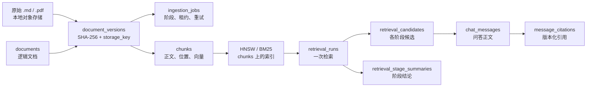

图中黄色“对象存储”如果在数据库客户端里找不到，是正常的：当前实现把原文件放在后端机器的本地文件系统。`pgvector` 和 `BM25` 也不是业务表，而是 `chunks` 表上的索引。真正的业务表定义见 [V2](../backend/src/main/resources/db/migration/V2__create_workspace_knowledge_and_ingestion.sql)、[V6](../backend/src/main/resources/db/migration/V6__create_chat_history.sql)、[V7](../backend/src/main/resources/db/migration/V7__create_production_retrieval.sql) 与 [V9](../backend/src/main/resources/db/migration/V9__record_retrieval_stage_outcomes.sql)。字段级中文释义见 [V10](../backend/src/main/resources/db/migration/V10__document_database_schema.sql)。

## 动态总览：入库与检索如何接成一条证据链

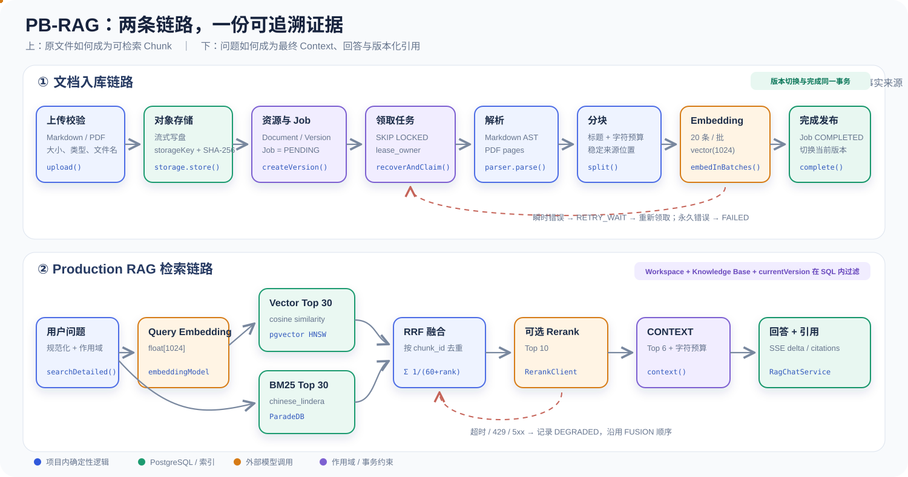

上半条链路把“不稳定的上传文件”变成“可复现、可定位、可检索的版本化 Chunk”；下半条链路把“用户问题”变成“真正进入回答 Prompt 的 CONTEXT 证据”。图中的流动圆点表示数据向前传递，红色虚线表示正常主路径之外的重试或降级。若阅读器禁用 SVG 动画，所有节点和连线仍可作为静态总览阅读。

两条链路通过 `chunks` 接起来，但职责不同：入库阶段负责生产 `content + source_position + embedding`，检索阶段只在确定的 Workspace、知识库和当前文档版本范围内读取这些数据。Vector 与 BM25 是并行召回，RRF 是确定性的排名融合，Rerank 是可选的远程精排，CONTEXT 才是实际交给 Chat 模型并转换成引用的最终证据。

### 关键编排代码地图

| 链路节点 | 当前代码入口 | 需要守住的工程边界 |
| --- | --- | --- |
| 上传与对象存储 | [`DocumentUploadServiceImpl.upload()`](../backend/src/main/java/dev/pbrag/ingestion/service/impl/DocumentUploadServiceImpl.java) | 文件系统与数据库不能共享事务，数据库失败时补偿删除对象 |
| 资源、版本和 Job | [`IngestionCreationServiceImpl`](../backend/src/main/java/dev/pbrag/ingestion/service/impl/IngestionCreationServiceImpl.java) | 内容 Hash 幂等；已有文档的新版本在完成前不切换生产版本 |
| 领取与阶段推进 | [`IngestionJobClaimService`](../backend/src/main/java/dev/pbrag/ingestion/service/IngestionJobClaimService.java)、[`IngestionWorker`](../backend/src/main/java/dev/pbrag/ingestion/service/IngestionWorker.java) | `SKIP LOCKED`、租约所有者、预期阶段和取消信号共同约束执行权 |
| 分块与向量写入 | [`MarkdownHeadingChunkingStrategy`](../backend/src/main/java/dev/pbrag/ingestion/chunking/MarkdownHeadingChunkingStrategy.java)、[`ChunkPersistenceService`](../backend/src/main/java/dev/pbrag/ingestion/service/ChunkPersistenceService.java) | 分块可复现；数量、维度或写入失败时整批回滚 |
| 完成与版本发布 | [`IngestionCompletionService.complete()`](../backend/src/main/java/dev/pbrag/ingestion/service/IngestionCompletionService.java) | Job 完成和 `current_version_id` 切换处在同一事务 |
| 双路召回 | [`ChunkRetrievalMapper.xml`](../backend/src/main/resources/mapper/retrieval/ChunkRetrievalMapper.xml) | Workspace、知识库和当前版本过滤必须发生在 SQL 内 |
| RRF、Rerank、CONTEXT | [`RetrievalServiceImpl`](../backend/src/main/java/dev/pbrag/retrieval/service/impl/RetrievalServiceImpl.java) | 异构原始分数不直接相加；远程瞬时故障显式降级；最终证据受 Top-K 和字符预算约束 |
| 回答与引用 | [`RagChatServiceImpl`](../backend/src/main/java/dev/pbrag/chat/service/impl/RagChatServiceImpl.java) | 无证据时确定性拒答；引用绑定 Chunk、文档版本和稳定来源位置 |

> 当前实现事实：已有文档的新版本由 `IngestionCompletionService` 在完成事务中切换；新建逻辑文档的首个版本仍在创建 Job 时提前写入 `current_version_id`。另外，`RetrievalServiceImpl.context()` 当前会保留第一条候选，即使它单独超过字符预算。这两处属于已识别但尚未在当前工作树完成的边界修正，阅读动画时不要把目标语义误认为所有路径都已验证满足。

下面假设用户在 `ws-A` 的 `kb-A` 上传 `worker.md`，然后提问“Worker 崩溃后任务如何恢复？”。

## 1. 上传：保存原文件和建立资源身份

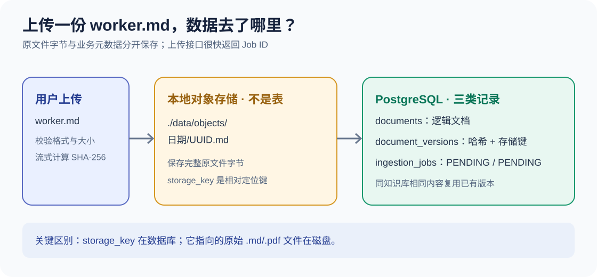

入口是 [IngestionController](../backend/src/main/java/dev/pbrag/ingestion/api/IngestionController.java)；[DocumentUploadServiceImpl](../backend/src/main/java/dev/pbrag/ingestion/service/impl/DocumentUploadServiceImpl.java) 校验格式和大小，调用 [LocalFileObjectStorage](../backend/src/main/java/dev/pbrag/ingestion/storage/LocalFileObjectStorage.java) 流式写盘并计算 SHA-256。默认根目录由 `pbrag.storage.local.root` 配置为 `./data/objects`；相对目录取决于后端进程工作目录，也可由 `PBRAG_STORAGE_ROOT` 覆盖。

```text
磁盘文件：  ./data/objects/2026-11-13/<uuid>.md
数据库值：  document_versions.storage_key = '2026-11-13/<uuid>.md'
数据库值：  document_versions.content_sha256 = '<原文件 SHA-256>'
```

`storage_key` 是定位原文件的相对键，`chunks.content` 则是稍后解析出来的片段文字。二者不是同一份数据。日期和 UUID 是存储文件名，不是文档版本号，也不是内容哈希。

[IngestionCreationServiceImpl](../backend/src/main/java/dev/pbrag/ingestion/service/impl/IngestionCreationServiceImpl.java) 在事务内锁定所属资源，检查同知识库的内容摘要。重复内容返回已有版本和 Job；新内容创建记录。对象存储与 PostgreSQL 不共享事务，所以数据库创建失败时上传服务会尝试删除刚写入的对象。

| 数据位置 | 新上传后的示例 | 意义 |
| --- | --- | --- |
| `documents` | `id=doc-A, knowledge_base_id=kb-A` | 一个逻辑文档身份，供用户管理 |
| `document_versions` | `id=ver-A, document_id=doc-A, version_number=1` | 一份不可变内容，绑定哈希和存储键 |
| `documents.current_version_id` | 新文档初始版本，或已有文档仍指向旧版 | 生产检索应读取哪份版本 |
| `ingestion_jobs` | `id=job-A, document_version_id=ver-A, status=PENDING, stage=PENDING` | 后台加工的事实来源 |

当前已有文档可以经版本上传接口创建递增版本。**更新已有文档时，新版本处理完成前，`current_version_id` 仍指向旧版本**；成功后才切换。参见 [IngestionCompletionService](../backend/src/main/java/dev/pbrag/ingestion/service/IngestionCompletionService.java)。

## 2. Worker：一行 Job 怎样向前走

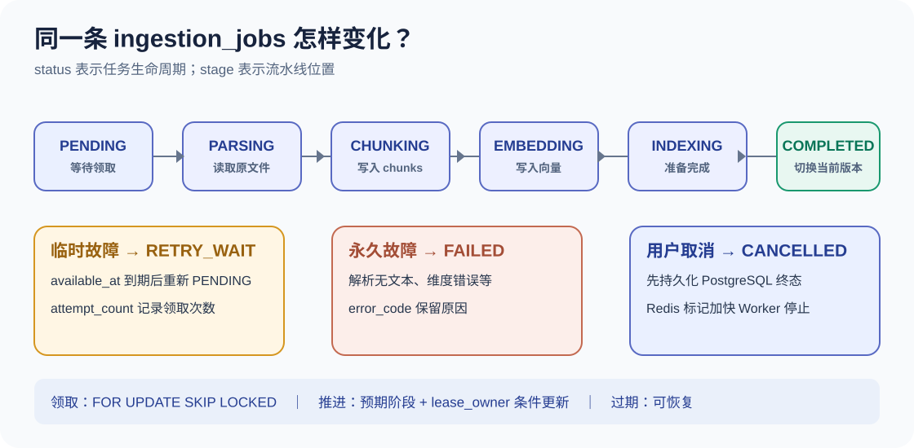

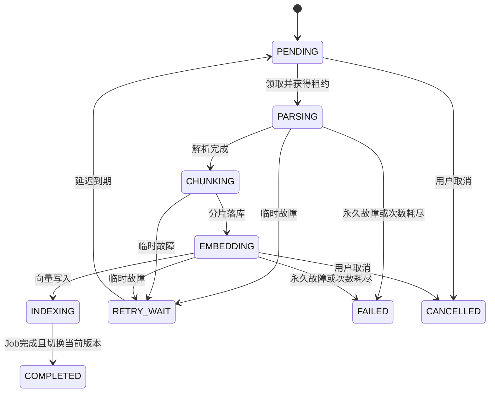

图为了易读把 `status` 与 `stage` 合并展示；数据库里它们是两个字段。例如 `RUNNING / EMBEDDING` 表示任务正在运行且执行到向量化，`RETRY_WAIT / EMBEDDING` 表示上次在向量化阶段失败并等待重试。`attempt_count` 是被 Worker 领取执行的次数，不是当前处理的 Chunk 数量。

[IngestionJobClaimService](../backend/src/main/java/dev/pbrag/ingestion/service/IngestionJobClaimService.java) 先恢复过期租约、激活到期重试，再领取任务。[IngestionJobMapper.xml](../backend/src/main/resources/mapper/ingestion/IngestionJobMapper.xml) 的关键语义是：

```sql
SELECT id FROM ingestion_jobs
WHERE status = 'PENDING' AND available_at <= CURRENT_TIMESTAMP
FOR UPDATE SKIP LOCKED
LIMIT 1;
```

多个 Worker 同时查询时，已锁定的 Job 被跳过。领取操作把 `status` 改为 `RUNNING`、`stage` 改为 `PARSING`，增加 `attempt_count`，写入 `lease_owner` 和 `lease_expires_at`。后续阶段推进要求“预期阶段 + 当前租约持有者”同时匹配；失去租约的旧 Worker 不应继续推进。Redis Pub/Sub 提醒实例尽快领取，PostgreSQL Job 表仍是事实来源，数据库轮询可以兜底。

| 字段 | 应怎样读 |
| --- | --- |
| `status` | 生命周期：待处理、运行、待重试、完成、失败或取消 |
| `stage` | 流水线走到哪一步；失败或待重试时可保留出错阶段 |
| `available_at` | 下一次最早领取时间，用于重试延迟 |
| `lease_owner` / `lease_expires_at` | 哪个 Worker 暂时拥有任务、租约何时过期 |
| `error_code` / `error_message` | 程序可判断的错误码、人可阅读的受限说明 |

临时模型连接错误会有限重试，永久解析错误和维度错误直接失败。取消首先持久化 `CANCELLED`，Redis TTL 标记让正在运行的 Worker 更快在阶段或批次边界停下。具体异常分类和边界检查在 [IngestionWorker](../backend/src/main/java/dev/pbrag/ingestion/service/IngestionWorker.java)。

## 3. 解析与分片：原文件变成带出处的 Chunk

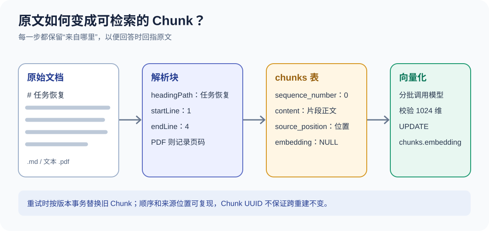

Worker 根据 `document_versions.storage_key` 打开原文件。[MarkdownDocumentParser](../backend/src/main/java/dev/pbrag/ingestion/parser/MarkdownDocumentParser.java) 用 CommonMark AST 保留标题路径、行号与字符偏移；[PdfDocumentParser](../backend/src/main/java/dev/pbrag/ingestion/parser/PdfDocumentParser.java) 按页提取普通文本 PDF，扫描件需要另行 OCR。解析器版本写回 `document_versions.parser_version`。

```text
原文：# 任务恢复
      Worker 租约过期后重新领取任务。

Chunk 0：content = "# 任务恢复…Worker 租约过期后重新领取任务。"
         sequence_number = 0
         source_position = {startLine, endLine, headingPath, chunkingVersion, ...}
         embedding = NULL       ← 此刻尚未向量化
```

[MarkdownHeadingChunkingStrategy](../backend/src/main/java/dev/pbrag/ingestion/chunking/MarkdownHeadingChunkingStrategy.java) 优先在标题变化和目标长度处切分，超大块受最大字符数约束。具体值以 [application.yml](../backend/src/main/resources/application.yml) 为准。`sequence_number` 从 0 开始；`start_offset` 包含起点、`end_offset` 不包含终点，位置基于解析后规范化的文本，不一定等于原始文件字节偏移。

[ChunkPersistenceService](../backend/src/main/java/dev/pbrag/ingestion/service/ChunkPersistenceService.java) 在事务内按版本删除旧 Chunk，再插入本次分片，避免重试制造重复片段；实际 SQL 在 [ChunkMapper.xml](../backend/src/main/resources/mapper/ingestion/ChunkMapper.xml)。Chunk UUID 可能随重建变化，所以“稳定”主要指版本、顺序和来源位置，不能把 Chunk UUID 理解为跨重建不变。

## 4. 向量化与索引：哪些是表，哪些不是

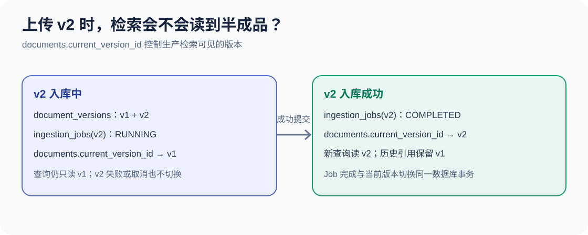

这张图讲的是已有文档上传新版本。新文档首次上传的当前版本建立时机不同；这里重点看“更新已有文档时，v2 处理期间仍检索 v1”。

Worker 分批把 Chunk 正文交给 Embedding 模型，校验返回数量和 1024 维长度后，更新 `chunks.embedding`。写入批次的事务边界在 `ChunkPersistenceService.writeEmbeddings()`。

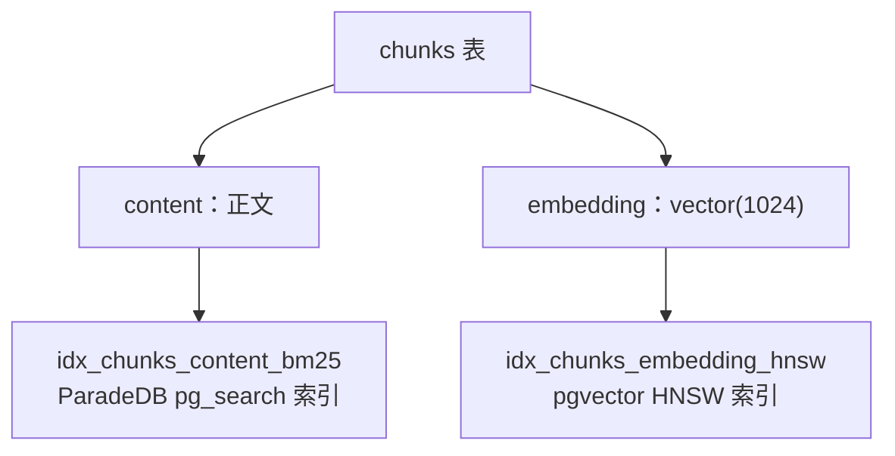

这两个 `idx_...` 是 PostgreSQL 索引，在数据库客户端的 `chunks → Indexes` 下查看。向量索引定义见 [V5](../backend/src/main/resources/db/migration/V5__change_chunk_embedding_to_1024.sql)，BM25 索引定义见 [V8](../backend/src/main/resources/db/migration/V8__replace_trigram_with_paradedb_bm25.sql)。正文和向量写入 `chunks` 时，数据库维护索引；`INDEXING` 是 Job 流水线阶段，并不意味着有一张 `indexing` 表或再调用一个独立索引服务。

入库完成后，[IngestionCompletionService](../backend/src/main/java/dev/pbrag/ingestion/service/IngestionCompletionService.java) 在同一事务内更新 `documents.current_version_id` 并把 Job 置为 `COMPLETED`。若事务失败，两个变化一起回滚。生产检索 SQL 要求 `d.current_version_id = dv.id`，所以处理中的新版本不会抢先进入正常搜索。

## 5. 提问：双路召回、融合和阶段留痕

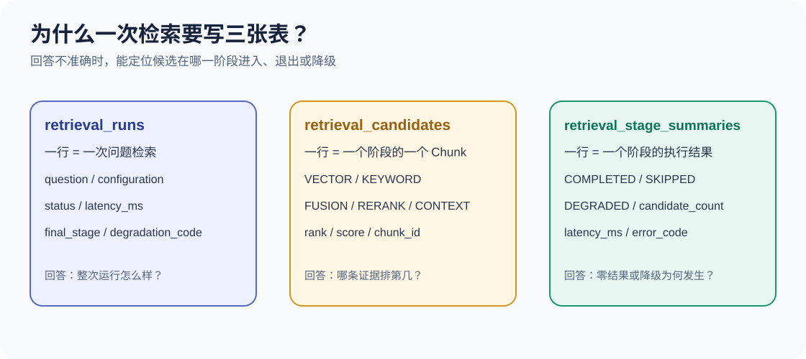

入口是 [RetrievalController](../backend/src/main/java/dev/pbrag/retrieval/api/RetrievalController.java)，编排在 [RetrievalServiceImpl](../backend/src/main/java/dev/pbrag/retrieval/service/impl/RetrievalServiceImpl.java)。一次请求先创建 `retrieval_runs` 的 `RUNNING` 行；问题转换成 Query Embedding 后，执行 [ChunkRetrievalMapper.xml](../backend/src/main/resources/mapper/retrieval/ChunkRetrievalMapper.xml) 中的两路查询。

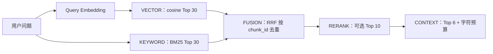

两路 SQL 都在数据库里限定 `workspace_id`、`knowledge_base_id` 和当前文档版本。向量路使用 `1 - cosine distance`，BM25 路使用 `paradedb.score(c.id)`；当前配置分别有最低相似度和 BM25 分数门槛。它们量纲不同，因此 RRF 只使用各自排名：

### 图解：BM25 与双路融合

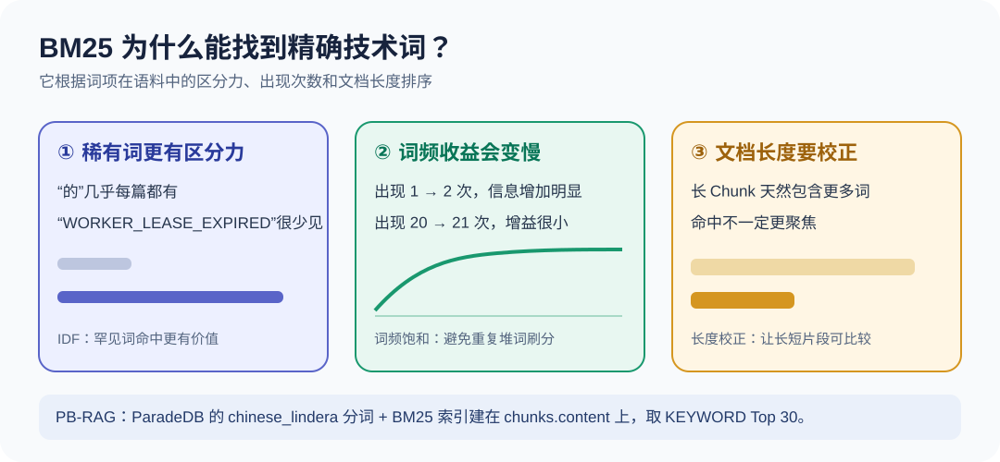

BM25 更容易找出错误码、类名、接口路径等字面精确的词项。图中解释的是 BM25 的算法直觉；具体分词和得分由当前 ParadeDB 索引实现决定，不能把示意条形长度当成实际分数。

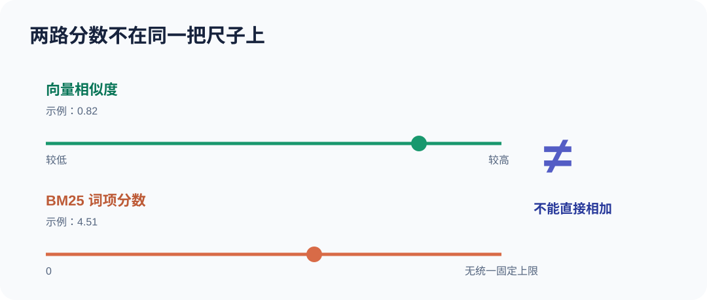

向量分数与 BM25 分数没有共同单位。图上的 `0.82` 和 `4.51` 是虚构示例，位置只表达“不同尺度”，不表示当前阈值或已测量分布。

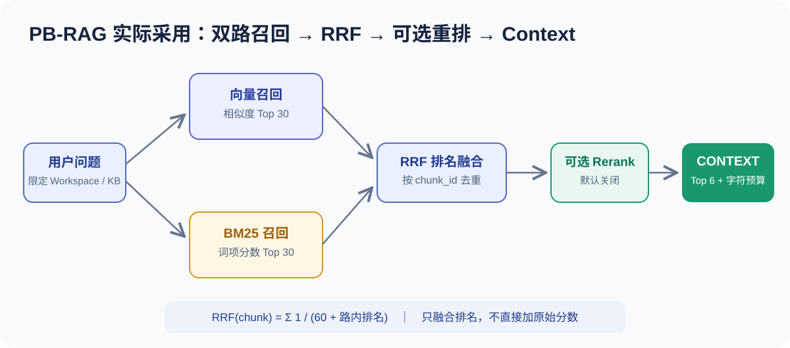

截图中“归一化 → 加权融合”是另一种可选策略；PB-RAG 当前代码采用固定 `RRF(k=60)`，按 `chunk_id` 去重后组合两路排名，不执行分数归一化或动态加权。上图与 `RetrievalServiceImpl.fuse()` 对应。

```text
RRF(chunk) = Σ 1 / (60 + 该 Chunk 在一路召回中的名次)
```

假设 Chunk A 在向量路排第 2、BM25 路排第 3，则 `1/62 + 1/63 ≈ 0.0320`。这个例子解释算法，不代表真实相关性得分。可选 Rerank 会读候选正文重新排序；默认关闭，瞬时故障时记录降级并沿用 FUSION。`CONTEXT` 最终限制条数和字符预算，是实际送给 Chat 模型的证据集合。

每一步同时写两类数据：[RetrievalRunMapper.xml](../backend/src/main/resources/mapper/retrieval/RetrievalRunMapper.xml)。

| 表 | 一行的含义 | 关键字段 |
| --- | --- | --- |
| `retrieval_runs` | 一次检索运行 | 问题、配置、状态、总耗时、`final_stage`、`degradation_code` |
| `retrieval_candidates` | 某阶段的一个候选 Chunk | `stage`、`rank`、`score`、Chunk 与版本 ID、元数据 |
| `retrieval_stage_summaries` | 某阶段的整体结论，零候选也保存 | `status`、候选数、耗时、错误码 |

`retrieval_candidates.score` 在 VECTOR 是相似度，在 KEYWORD 是 BM25 分数，在 FUSION 是 RRF 分数，在 RERANK 是模型分数。不要跨阶段直接比较。`retrieval_runs.final_stage` 表示最终排序来自 FUSION 还是 RERANK；CONTEXT 负责预算裁剪。阶段摘要能区分“零结果”“Rerank 未启用”“Rerank 失败后降级”。目前阈值与质量收益仍需 `retrieval-v1` 固定数据集校准，不能仅凭实现推断效果提升。

## 6. 回答：消息和引用怎样固定下来

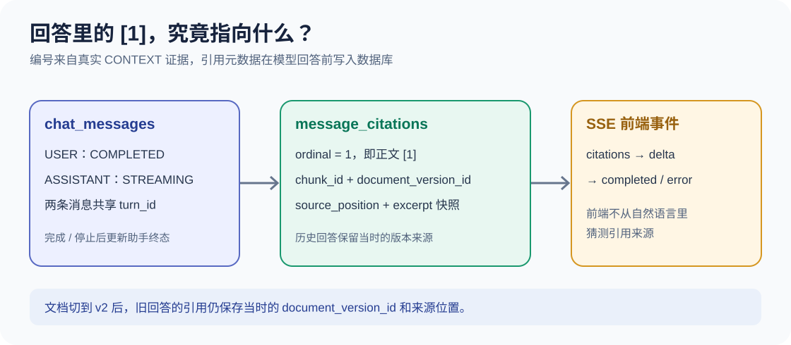

[RagChatServiceImpl](../backend/src/main/java/dev/pbrag/chat/service/impl/RagChatServiceImpl.java) 在检索前通过 [ChatHistoryServiceImpl](../backend/src/main/java/dev/pbrag/chat/service/impl/ChatHistoryServiceImpl.java) 创建或复用 `chat_sessions`，并在同一轮 `turn_id` 下创建两条 `chat_messages`：用户消息立即 `COMPLETED`，助手占位消息先为 `STREAMING`。

检索返回的 CONTEXT 结果转成 `message_citations`，每条引用保存 `chunk_id`、`document_id`、`document_version_id`、来源位置、受限原文摘录和编号。SSE 先发引用，再逐段发送回答。完成或中断时，助手消息变为 `COMPLETED` 或 `INTERRUPTED` 并保存正文或已生成的部分正文。对应 SQL 见 [ChatHistoryMapper.xml](../backend/src/main/resources/mapper/chat/ChatHistoryMapper.xml)。没有合格证据时由 Java 直接返回拒答，不调用 Chat 模型。

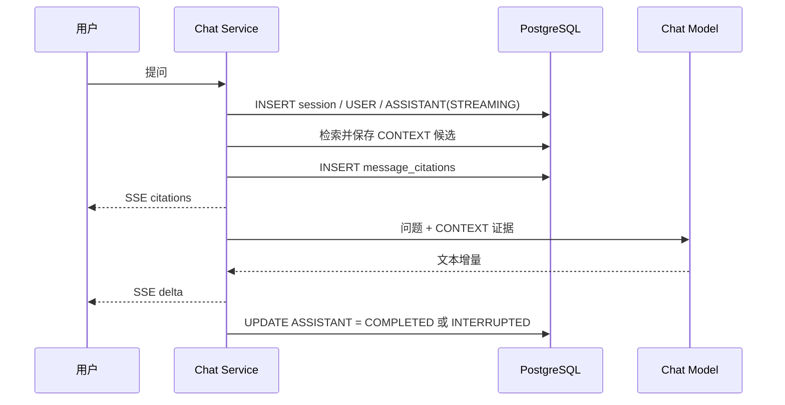

引用绑定文档版本，因此文档后来切到 v2，历史回答仍可知道当时引用的是 v1。需要注意：检索候选留痕表为避免阻塞 Chunk 重建，没有对 Chunk 建删除外键；聊天引用表则有 Chunk 外键。重建已被引用版本的 Chunk 时，必须关注该约束和历史引用的保留语义，不能简单假设任意删除都会成功。

## 7. 去数据库里亲手观察

下列查询只读；把参数换成自己环境的 UUID。先看 Job，再沿版本找到 Chunk，最后看一次检索的阶段。

```sql
SELECT id, document_version_id, status, stage, attempt_count,
       lease_owner, lease_expires_at, error_code, updated_at
FROM ingestion_jobs
WHERE workspace_id = :workspace_id
ORDER BY created_at DESC
LIMIT 10;
```

```sql
SELECT d.id AS document_id, d.display_name, d.current_version_id,
       v.id AS version_id, v.version_number, v.content_sha256,
       v.storage_key, v.parser_version
FROM documents d
JOIN document_versions v ON v.workspace_id = d.workspace_id AND v.document_id = d.id
WHERE d.workspace_id = :workspace_id AND d.knowledge_base_id = :knowledge_base_id
ORDER BY d.created_at DESC, v.version_number DESC;
```

```sql
SELECT sequence_number, left(content, 120) AS preview,
       source_position, embedding IS NOT NULL AS embedded
FROM chunks
WHERE workspace_id = :workspace_id AND document_version_id = :version_id
ORDER BY sequence_number;
```

```sql
SELECT r.id, r.status, r.final_stage, r.degradation_code,
       s.stage, s.status AS stage_status, s.candidate_count, s.latency_ms, s.error_code
FROM retrieval_runs r
JOIN retrieval_stage_summaries s ON s.retrieval_run_id = r.id
WHERE r.workspace_id = :workspace_id AND r.id = :run_id
ORDER BY CASE s.stage WHEN 'VECTOR' THEN 1 WHEN 'KEYWORD' THEN 2
         WHEN 'FUSION' THEN 3 WHEN 'RERANK' THEN 4 ELSE 5 END;
```

应用 V10 后，数据库客户端刷新 Schema 即可看到字段中文注释。若要直接用 SQL 看注释，可查 `pg_catalog.col_description`。V9/V10 是否已应用，以你连接的数据库 `flyway_schema_history` 为准，不要只看仓库里有没有迁移文件。

## 8. 最容易混淆的五件事

1. `object storage` 是后端本地磁盘实现；`document_versions.storage_key` 只是数据库里的文件定位键。
2. HNSW 与 BM25 是 `chunks` 的两个索引；没有名叫 `pgvector + BM25` 的业务表。
3. `documents` 是逻辑身份，`document_versions` 是内容快照，`chunks` 属于某个具体版本。
4. `ingestion_jobs.status` 表示任务是否在运行，`stage` 表示处理到哪里；失败和重试时不能只读其中一个字段。
5. `retrieval_candidates.score` 必须结合 `stage` 解释；引用的版本和来源位置保存在 `message_citations`，不能只依赖模型输出的 `[1]` 文本。
