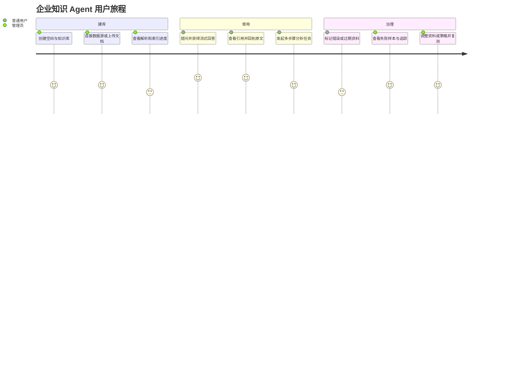
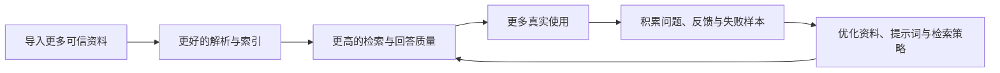
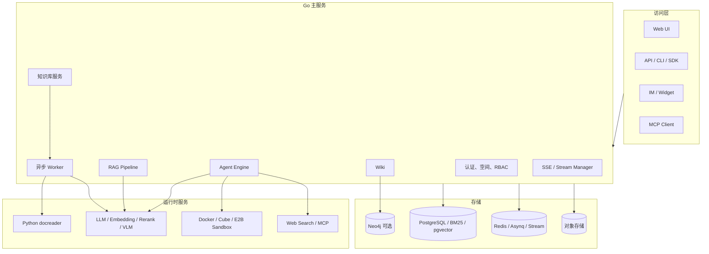

# WeKnora 项目拆解与 Agent 产品路线图

> 文档版本：v0.1
> 调研日期：2026-10-24
> 目标：从开发、产品和用户三个视角吃透腾讯 WeKnora，并据此设计一个可验证、可演进的 Agent 项目。

## 0. 先说结论

WeKnora 不只是“给文档套一层聊天界面”，而是一套以企业知识为底座的 AI 应用平台：

1. **RAG 问答**解决“从资料中快速找到有出处的答案”；
2. **Agent 推理**解决“需要多步检索、分析和调用工具才能完成的任务”；
3. **自动 Wiki**解决“知识如何被持续整理、关联、修订和复用”。

三类能力共享同一套知识库、权限、模型、检索、任务队列和可观测体系。这种“统一知识底座 + 多种消费方式”的设计，是 WeKnora 最值得借鉴的部分。

如果我们的目标是做自己的 Agent 产品，建议不要立刻复制全部功能。正确顺序是：

```text
跑通 WeKnora → 画清核心链路 → 建立效果评测 → 选择一个真实场景 →
用最小闭环验证 → 再决定扩展 WeKnora、深度二开，还是逐步替换核心模块
```
首个版本建议只做一个“可验证的知识型 Agent”：能导入资料，能给出带引用的回答，能在必要时使用少量工具，并且能看见每一步耗时、成本和依据。

---

## 1. 先建立正确的产品认知

### 1.1 它解决的不是“聊天”，而是知识工作流

普通聊天机器人关注“回答像不像人”；企业知识 Agent 更关注：

- 答案是否来自允许访问的资料；
- 能否指出证据并跳回原文；
- 遇到证据不足时是否诚实拒答；
- 是否能组合搜索、读取、计算、浏览器和 MCP 工具完成任务；
- 是否可追踪、可审计、可控制成本；
- 文档更新后，答案能否及时更新。

因此，最终产品价值不是模型参数，而是下面这个乘法：

```text
产品价值 = 资料覆盖率 × 解析质量 × 检索命中率 × 推理可靠性 × 使用频率
```

任何一项接近零，整体体验都会很差。

### 1.2 RAG、Agent、Wiki 的边界

| 能力 | 用户问题 | 系统行为 | 适合场景 |
|---|---|---|---|
| 快速问答 | “报销上限是多少？” | 一次检索、重排、生成 | 明确事实、单跳问题、低延迟 |
| Agent | “比较三份合同并列出风险” | 规划，多次检索/读取/计算/调用工具 | 多文档、多步骤、需要操作 |
| Wiki | “帮我理解这个业务领域” | 把散乱资料整理为页面与关系 | 新人上手、知识治理、持续维护 |

关键判断：**不是每个问题都应该进入 Agent 循环。** 简单问题走固定 RAG 管线，通常更快、更便宜，也更稳定；复杂任务再交给 Agent。

---

## 2. 从用户角度理解产品

### 2.1 三类核心用户

#### A. 知识消费者

典型角色：员工、客服、售前、研发、管理者。

他们并不关心向量库或分块算法，只关心：

- 我能不能快速得到正确答案？
- 答案依据在哪里？
- 我有没有权限看到这些内容？
- 答错后能不能纠正？
- 复杂任务是否真的帮我节省时间？

#### B. 知识管理员

典型角色：业务专家、运营、IT 管理员。

他们关心：

- 哪些资料已导入、哪些失败、为什么失败？
- 文档更新后能否增量同步？
- 如何调整解析、切块、检索和问答策略？
- 谁能访问哪个知识库？
- 哪些问题回答不好，如何定位和改进？

#### C. 平台开发者

他们关心：

- 能否通过 API、SDK、MCP、Widget、IM 快速接入；
- 模型、向量库、解析器和工具是否可替换；
- 是否有追踪、日志、评测和成本数据；
- 扩展一个新数据源或新工具需要改多少代码。

### 2.2 一条完整用户旅程



### 2.3 用户真正可感知的质量指标

| 指标 | 用户感知 | 建议测量方式 |
|---|---|---|
| 首字延迟 | “系统反应快不快” | P50/P95 Time to First Token |
| 任务完成时间 | “多久能拿到结果” | 端到端 P50/P95 |
| 引用正确率 | “出处是否真的支持答案” | 人工标注 + 自动判定 |
| 拒答准确率 | “不知道时会不会胡说” | 无答案题集 |
| 任务成功率 | “Agent 最终有没有做成” | 场景化成功标准 |
| 工具成功率 | “搜索、读取、计算是否稳定” | 按工具统计成功/失败/重试 |
| 单任务成本 | “规模化是否可用” | Token、搜索、解析、沙箱成本 |

“用户点赞率”可以参考，但不能代替引用正确率和任务成功率。

---

## 3. 从产品经理角度拆解 WeKnora

### 3.1 产品飞轮



真正的护城河不是“接入了多少模型”，而是持续积累的企业知识、真实问题、评测集、反馈闭环和工作流集成。

### 3.2 功能分层

| 层级 | 能力 | 产品意义 |
|---|---|---|
| 数据层 | 文件、网页、飞书、Notion、Confluence 等 | 决定知识覆盖面和更新时效 |
| 知识层 | 解析、切块、摘要、标签、向量/BM25、图谱、Wiki | 把原始文件转成可检索知识 |
| 智能层 | RAG、ReAct Agent、记忆、技能、MCP、沙箱 | 把知识转成答案与行动 |
| 交付层 | Web、API、CLI、IM、Widget、MCP Server | 把能力放进用户已有工作场景 |
| 治理层 | RBAC、审计、评测、追踪、成本和任务监控 | 让系统可上线、可运营、可负责 |

### 3.3 产品定位不要写成“通用 AI 平台”

首期应该选择一个窄场景，例如：

- 技术文档助手：跨 README、设计文档和代码说明回答并定位出处；
- 售前方案 Agent：读取产品资料，按客户需求生成有依据的方案；
- 合同审查 Agent：对照条款库和模板发现差异与风险；
- 客服知识 Agent：优先命中标准 FAQ，复杂问题再检索文档；
- 研究分析 Agent：跨多份资料总结、比较、形成报告。

选择场景时，用四个问题筛选：

1. 用户是否每周至少遇到多次？
2. 当前任务是否耗时且步骤相对稳定？
3. 是否存在可信资料和可判定的好结果？
4. 出错的风险是否能通过引用、审批和权限控制？

### 3.4 MVP 建议

#### 必须有

- 单租户或简单工作空间；
- PDF、DOCX、Markdown、网页导入；
- 异步解析状态与失败原因；
- 向量 + BM25 混合检索；
- Rerank；
- 带引用的流式问答；
- 一个 Agent，只有 3～5 个白名单工具；
- 基本会话历史；
- 全链路日志、耗时、Token 和错误追踪；
- 一套 50～100 题的离线评测集。

#### 首期不要有

- 同时支持十几种向量数据库；
- 复杂 GraphRAG；
- 自动 Wiki 全功能；
- 二十多家模型供应商；
- 大量 IM 渠道；
- 无限制自主 Agent；
- 复杂多租户计费。

这些功能有价值，但不应先于“一个场景真的好用”。

---

## 4. 从开发角度理解官方架构

根据官方当前架构文档，WeKnora 的默认核心是：Vue 3 前端、Go 主服务、Python `docreader`、PostgreSQL/ParadeDB 和 Redis。向量库、Neo4j、MinIO、SearXNG、Langfuse 等按需启用。



### 4.1 三条必须吃透的主链路

#### 链路一：文档入库

```text
上传/同步
  → 写业务记录并入队
  → 文档解析/OCR/版面识别
  → 清洗和分块
  → Embedding
  → 写向量索引与 BM25 索引
  → 摘要/问题/图片描述/图谱等富化任务
  → 状态完成
```

这条链路决定“系统知道什么”。官方实现使用 Redis + Asynq 把耗时处理放入多个 Worker 池，HTTP 请求只负责落库和入队。这样可以处理大文件、失败重试和横向扩容。

需要重点研究：

- 不同格式如何归一化为结构化文本；
- 标题、页码、表格、图片等元数据是否保留；
- 固定长度、标题感知、父子分块各自适用什么资料；
- 文档重解析时，旧 chunk 和索引如何原子替换；
- 模型限流、批量 embedding、任务重试与幂等如何实现；
- 用户如何看到每个阶段的进度和失败原因。

#### 链路二：RAG 问答

```text
加载历史/记忆
  → 查询理解、改写、实体提取
  → 向量与关键词并行检索
  → 融合、Rerank、邻接扩展与合并
  → Top-K 截断
  → 组装带来源的上下文
  → LLM 流式生成
  → 引用展开、消息落库、SSE 推送
```

官方把问答实现成事件驱动插件管线。这个设计让查询理解、检索、重排、合并、数据分析和生成可以独立扩展，也方便追踪每个阶段。

需要重点研究：

- 向量检索和关键词检索怎样融合；
- 阈值、Top-K、RRF 权重和 Rerank 如何调；
- 相邻 chunk 如何合并，怎样避免上下文碎片化；
- 如何让模型引用内部别名，而不是伪造原始 ID；
- 无结果、弱证据、模型超时和客户端断线如何处理；
- 如何把检索质量和最终生成质量分开评测。

#### 链路三：Agent 推理

```text
用户目标
  → 加载 Agent 配置、权限、知识库和工具白名单
  → LLM 判断下一步
  → 调用知识搜索/读全文/Web/MCP/技能/沙箱工具
  → 把观察结果加入上下文
  → 继续推理或结束
  → 输出答案、产物、引用和执行轨迹
```

WeKnora 区分 `quick-answer` 和 `smart-reasoning`：前者走固定 RAG，后者进入 ReAct 多轮循环。Agent 的价值不在“多想几轮”，而在能够基于受控工具获得新信息或执行动作。

需要重点研究：

- Tool Registry 和工具 JSON Schema 如何定义；
- 工具选择、最大迭代、超时、取消和重试；
- MCP OAuth 和危险工具的人在回路审批；
- 技能如何渐进式加载，代码如何在沙箱隔离执行；
- 长上下文如何压缩，记忆何时读写；
- 工具结果和图片怎样进入模型上下文；
- 如何防止提示词注入、越权访问和 SSRF。

### 4.2 为什么默认先用 PostgreSQL

早期项目使用 PostgreSQL + pgvector + BM25 的优点：

- 业务数据、关键词索引和向量索引更容易保持一致；
- 部署组件少，开发和备份简单；
- 数据量尚未证明需要独立向量库；
- 可以先把精力放在解析、检索策略和评测上。

只有在规模、吞吐、延迟或检索能力形成明确瓶颈后，再引入 Qdrant、Milvus、Elasticsearch 等专用引擎。

---

## 5. 建议的源码阅读地图

> 下面按“请求经过系统的顺序”阅读，不建议从目录树第一页开始逐文件看。

### 第一轮：跑通与建立全局地图

1. `README_CN.md`、`docker-compose.yml`、`.env.example`、`Makefile`；
2. `cmd/server`：进程如何启动；
3. `internal/container/container.go`：依赖如何注册；
4. `internal/router/`：API 如何分组；
5. `frontend/src/router` 与核心 API client：页面如何进入后端；
6. 完整跑一遍“建库 → 上传 → 解析完成 → 提问 → 查看引用”。

输出物：一张组件图、一张请求时序图、启动依赖清单。

### 第二轮：吃透文档入库

建议跟踪一次真实文件上传，重点阅读：

- `internal/handler/knowledge.go`；
- 知识库与知识服务相关 application service；
- `internal/task/` 与文档处理 Worker；
- `docreader/main.py`、`docreader/parser/`；
- chunking、embedding、索引写入相关实现；
- `migrations/versioned/` 中 knowledge/chunk/task 相关表。

实践题：增加一种 Markdown 特殊分块策略，并用相同问题集比较前后召回率。

### 第三轮：吃透 RAG

建议从入口一路打断点：

- `internal/handler/session/qa.go`；
- `internal/application/service/session_knowledge_qa.go`；
- `internal/application/service/chat_pipeline/`；
- `internal/application/service/knowledgebase_search*.go`；
- `internal/modelcontext/`；
- `internal/stream/`；
- `config/prompt_templates/`。

实践题：输出每个问题的关键词召回、向量召回、融合排名、Rerank 分数和最终引用，并定位 10 个失败样本。

### 第四轮：吃透 Agent

重点阅读：

- `internal/handler/custom_agent.go`；
- `internal/application/service/agent_service.go`；
- `internal/application/service/session_agent_qa.go`；
- `internal/agent/engine.go`；
- `internal/agent/tools/`；
- `internal/agent/skills/`；
- `internal/agent/approval/`；
- `internal/sandbox/`；
- `config/agent_type_presets.yaml`。

实践题：实现一个只读业务工具，例如“查询产品库存”或“查询项目状态”，要求具备参数校验、权限校验、超时、审计日志和可读错误信息。

### 第五轮：治理与生产化

研究 RBAC、API Key 范围、OIDC、审计日志、限流、Langfuse、任务队列面板、备份恢复和滚动升级。

实践题：模拟模型超时、Redis 重启、解析失败、工具返回恶意文本和用户中途取消，检查系统是否可恢复、可解释。

---

## 6. 我们自己的项目应该如何设计

### 6.1 推荐的第一阶段架构

已接受的技术栈见 `docs/adr/0001-主服务采用-spring-boot-与-spring-ai.md`。保留 WeKnora 的机制，缩小技术面：

| 模块 | 第一阶段建议 | 原因 |
|---|---|---|
| 前端 | Vue 3、TypeScript、Vite、Pinia、TDesign | 只保留知识库、对话、运行和评测页面，见 ADR 0002 |
| API 服务 | Java 21、Spring Boot、Spring MVC、虚拟线程 | 包级模块化单体，暂不拆微服务 |
| 模型与工具基础设施 | Spring AI | 复用模型、Embedding、工具 Schema 和观测 |
| 文档解析 | Java 处理 Markdown 和普通 PDF；复杂文档再接 Python | 先打通主链路，再隔离重依赖 |
| 数据库 | PostgreSQL + pgvector、JDBC、Flyway | 减少组件，事务一致性好 |
| 任务 | PostgreSQL 任务表；Redis 负责唤醒、取消标记和限流 | 解析与索引必须异步，且崩溃后可恢复 |
| 模型 | 一个主 LLM、一个 embedding、一个 reranker | 先建立稳定基线 |
| Agent | 自研 ReAct Runtime + 工具白名单 + 最大轮数 | 可控优先；框架默认 Tool Loop 只作对照 |
| 可观测 | Micrometer Observation、OpenTelemetry，按需接入 Langfuse | 从第一天记录质量与成本 |

### 6.2 建议先定义的领域接口

```java
public interface Parser {
    ParsedDocument parse(DocumentInput input);
}

public interface Chunker {
    List<Chunk> split(ParsedDocument document, ChunkConfig config);
}

public interface Embedder {
    List<float[]> embed(List<String> texts);
}

public interface Retriever {
    List<Candidate> search(SearchQuery query);
}

public interface Reranker {
    List<Candidate> rerank(String query, List<Candidate> documents);
}

public interface Tool {
    String name();
    JsonSchema schema();
    ToolResult execute(JsonNode arguments);
}
```

接口的价值是能替换实现、做离线评测、注入故障和写契约测试。调用时同时携带 Workspace 作用域、调用者身份和取消信号。这些上下文由应用代码维护，不从模型输出中恢复。

### 6.3 最小数据模型

```text
workspace
user / workspace_member / role
knowledge_base
document / document_version
chunk / chunk_revision
ingestion_job / job_stage
model_provider / model
agent / agent_tool_binding
session / message / message_citation
tool_execution
evaluation_dataset / evaluation_case / evaluation_run
audit_log
```

三个不可省略的设计：

1. 文档和 chunk 要有版本，便于重建索引与追溯引用；
2. 每个回答引用要保存当时的 chunk 快照或版本号；
3. 每个工具调用要保存调用者、参数摘要、耗时、结果状态和审批记录。

### 6.4 Agent 工具的首期白名单

- `search_knowledge(query, kb_ids, top_k)`：检索摘要级证据；
- `read_document(document_id, range)`：按需读取原文；
- `list_documents(kb_id, filters)`：发现可用资料；
- 一个领域只读工具；
- 可选 `calculator` 或受限数据分析工具。

不要一开始开放任意 Shell、任意网络请求或写操作。写操作必须带权限、审批、幂等键和审计。

---

## 7. 评测体系：先测检索，再测回答，最后测 Agent

### 7.1 三层评测

| 层 | 核心问题 | 指标示例 |
|---|---|---|
| 检索层 | 正确证据有没有被找回来？ | Recall@K、MRR、NDCG、命中文档率 |
| 回答层 | 回答是否正确且被证据支持？ | 正确性、完整性、引用精确率、忠实度、拒答率 |
| Agent 层 | 是否用合理步骤完成任务？ | 任务成功率、无效工具调用数、恢复率、成本、时延 |

### 7.2 评测集如何建设

每个样本至少包含：

```yaml
question: 用户真实问题
expected_answer: 参考答案或判定规则
evidence:
  - document_id: 文档标识
    chunk_or_page: 证据位置
answerable: true
scenario: 单跳事实 | 多跳比较 | 无答案 | 时效性 | 权限边界
```

样本来源按优先级排序：真实历史问题、业务专家设计、线上失败样本、合成边界样本。每次修改分块、embedding、检索权重、Rerank、提示词或模型后，都必须重跑同一套基线。

### 7.3 首期验收线示例

- 核心题集 Recall@10 ≥ 90%；
- 有答案问题引用支持率 ≥ 90%；
- 无答案问题正确拒答率 ≥ 85%；
- 简单问答 P95 首字延迟 ≤ 3 秒；
- Agent 目标任务成功率 ≥ 80%；
- 任何用户都不能通过检索或工具越过知识库权限。

具体数字需按业务难度调整，但上线前必须有明确阈值。

---

## 8. 安全与可靠性底线

知识 Agent 同时面对用户输入、文档内容、网页内容和工具结果，所有这些都可能包含恶意指令。

最低要求：

- 鉴权过滤必须发生在检索前，不能先召回再让模型“别说”；
- 工具按 Agent 和用户双重权限取交集；
- 外部 URL 做协议、DNS/IP、重定向和响应大小校验，防 SSRF；
- 密钥加密保存，不进入 Prompt、日志和工具回显；
- 文档中的指令视为数据，不得覆盖系统规则；
- 高风险写操作必须人工审批；
- 沙箱限制网络、文件系统、CPU、内存和执行时间；
- SSE 断线、取消、超时和重试必须有确定状态；
- 异步任务必须幂等，并有死信、补偿和人工重跑入口；
- 保存完整审计链，但对敏感正文和参数做脱敏。

---

## 9. 六周学习与验证计划

### 第 1 周：能跑、能讲清

- 部署官方项目；
- 完成一次端到端用户旅程；
- 画组件图和部署图；
- 记录所有依赖、端口、数据卷和模型调用；
- 输出《WeKnora 本地运行手册》。

### 第 2 周：吃透入库

- 跟踪一个 PDF 从上传到索引完成；
- 对比两种分块策略；
- 制造解析失败并理解重试和状态机；
- 输出《文档入库时序与数据模型》。

### 第 3 周：吃透 RAG

- 为 50 个真实问题标注证据；
- 导出向量、关键词、融合、Rerank 各阶段结果；
- 分析至少 10 个失败样本；
- 输出第一版检索评测报告。

### 第 4 周：吃透 Agent

- 跟踪 ReAct 每一轮模型输入输出；
- 新增一个只读领域工具；
- 测试超时、错误、取消和最大迭代；
- 输出《Agent 工具开发规范》。

### 第 5 周：形成自己的 MVP

- 选定一个垂直场景和目标用户；
- 裁剪功能，定义首期验收指标；
- 做出品牌化界面或领域工作流；
- 接入真实数据和权限模型。

### 第 6 周：评测与决策

- 跑回归评测和小规模用户测试；
- 统计质量、延迟、成本和失败分布；
- 决定下一阶段走向：插件扩展、深度二开或替换核心；
- 输出技术方案、产品 PRD 和 90 天路线图。

---

## 10. 二开、借鉴重写，还是从零做

| 方案 | 适合情况 | 优点 | 风险 |
|---|---|---|---|
| 直接部署 + 配置 | 目标是快速内部使用 | 最快获得完整能力 | 差异化有限 |
| WeKnora 二次开发 | 需求与知识平台高度一致 | 复用完整工程能力 | 需要跟进上游，改动边界要清晰 |
| 只复用协议/服务 | 已有自己的业务平台 | 可把 WeKnora 当知识服务或 MCP 服务 | 两套权限和数据一致性需设计 |
| 借鉴后重写 | 场景非常窄或技术栈有强约束 | 架构可完全围绕业务优化 | 容易低估解析、权限、评测和运维成本 |

当前建议：**先部署学习，再围绕一个场景做薄层二开。** 在真实评测证明现有架构无法满足关键指标之前，不建议重写文档解析、混合检索、流式会话和 Agent 工具框架。

### 开源使用提醒

WeKnora 主体采用 MIT License，但第三方组件可能有各自许可证。商用或再分发时应保留许可证与版权声明，并检查 `THIRD_PARTY_NOTICES.md` 和各组件条款；“参考产品”也不意味着可以直接使用腾讯商标或造成官方背书的印象。

---

## 11. 我们下一步需要确定的五个产品问题

1. 第一批用户是谁，他们最频繁、最耗时的知识任务是什么？
2. 首批资料在哪里，是否有权限、版本和更新机制？
3. 好答案如何判定，谁能提供 50～100 个真实评测样本？
4. Agent 只读信息，还是需要执行写操作？哪些动作必须审批？
5. 部署边界是什么：本地、内网、私有云还是公网 SaaS？

回答完这五个问题，就可以把本文进一步收敛成：

- 一份产品 PRD；
- 一份技术架构设计；
- 一份源码学习任务清单；
- 一个可运行的 MVP backlog。

---

## 12. 官方资料与调研依据

以下结论以 2026-10-24 可访问的官方仓库与文档为准，后续版本可能变化：

1. [Tencent/WeKnora 官方仓库](https://github.com/Tencent/WeKnora)
2. [WeKnora 产品介绍](https://github.com/Tencent/WeKnora/blob/main/website-docs/01-getting-started/01-introduction.md)
3. [总体架构](https://github.com/Tencent/WeKnora/blob/main/website-docs/02-architecture/01-overview.md)
4. [文档入库流程](https://github.com/Tencent/WeKnora/blob/main/website-docs/02-architecture/03-document-pipeline.md)
5. [RAG Pipeline](https://github.com/Tencent/WeKnora/blob/main/website-docs/02-architecture/04-rag-pipeline.md)
6. [Agent 引擎](https://github.com/Tencent/WeKnora/blob/main/website-docs/03-features/07-agent.md)
7. [官方许可证](https://github.com/Tencent/WeKnora/blob/main/LICENSE)

---

## 附录 A：学习过程中每个模块都要回答的问题

对任何模块，不要只看“代码做了什么”，都要回答下面七个问题：

1. 它服务哪个用户目标？
2. 输入、输出和状态分别是什么？
3. 正常路径的关键步骤是什么？
4. 失败、超时、取消和重试如何处理？
5. 权限和租户边界在哪里检查？
6. 如何观测、测试和评估它？
7. 如果数据量或并发扩大 100 倍，最先坏在哪里？

## 附录 B：推荐的阶段性交付物

```text
docs/
├── 01-产品定位与用户旅程.md
├── 02-本地部署与依赖说明.md
├── 03-系统组件与部署架构.md
├── 04-文档入库时序与状态机.md
├── 05-RAG检索链路与评测报告.md
├── 06-Agent循环与工具开发规范.md
├── 07-权限安全与威胁模型.md
├── 08-MVP-PRD.md
└── 09-技术方案与90天路线图.md
```
